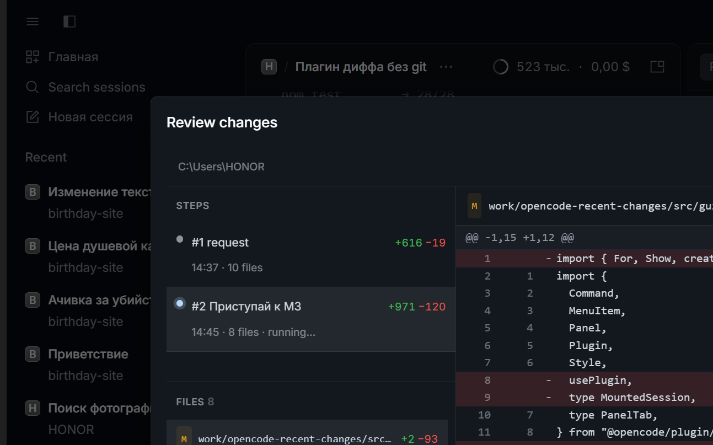

# Recent Changes

Cursor-style review of the agent's recent code changes for **OpenCode Desktop**.
Steps are grouped by user request, diffs are computed locally, and **git is not
used at all**.



## Features

- **Per-request timeline** — every user prompt becomes a step; changes are
  grouped by request, not by tool call.
- **Git-compatible unified diff** — `diff --git`, `index` (git blob SHA-1),
  hunks, function context, `\ No newline`, CRLF, binary. Output matches
  `git diff --no-index -U3` on the test fixtures.
- **No git** — snapshots live in a content-addressed blob store; the plugin
  works in a folder without a repository.
- **Review dialog** — steps, files (`M/A/D`, `+N −M`), diff with line numbers
  and colors. `Expand` opens a fullscreen overlay inside OpenCode.
- **Per-step and per-file actions** — Accept (mark reviewed), Restore (revert
  to the end of a step), Refresh, Copy patch.
- **Step-by-step rollback** — restore to any earlier step; the history is kept
  as a restore step, so you can go back and forth.
- **Conflict protection** — if a file changed on disk outside the plugin, a
  restore requires explicit overwrite.
- **Live updates** — the dialog refreshes after every tool call (debounced).

## Requirements

- OpenCode Desktop **2.2.x**
- Node.js 20+ and npm (for building the GUI bundle)

## Install

```powershell
cd C:\Users\HONOR\work\opencode-recent-changes
npm install
npm run build
```

Add the plugin to the **global** OpenCode config (Desktop reads only
`opencode.json(c)`, not `cli.json`):

```jsonc
{
  "$schema": "https://opencode.ai/config.json",
  "plugins": [
    {
      "package": "C:/Users/HONOR/work/opencode-recent-changes",
      "options": {
        "maxFileSize": 2097152,
        "contextLines": 3,
        "debug": false
      }
    }
  ]
}
```

Reload the Desktop window (`Ctrl+R`) or restart the app. The server part reloads
on config changes; the GUI bundle reloads after `npm run build` or
`npm run dev`.

## Usage

| Action | How |
|---|---|
| Open review | `/changes`, `Ctrl+Shift+D`, or the command palette → **Review recent changes** |
| Fullscreen | **Expand** in the dialog footer or the panel header |
| Collapse | **Collapse** in the fullscreen header |
| Select step | click a step in the left timeline |
| Select file | click a file in the file list |
| Accept step | **Accept** in the panel header |
| Accept file | `✓` in the file row, or **Accept** in the diff header |
| Restore step | **Restore** in the panel header |
| Restore file | `↺` in the file row, or **Restore** in the diff header |
| Refresh file | **Refresh** in the diff header |
| Copy patch | **Copy** in the diff header |

A restore asks for confirmation. If the file changed on disk, a second
confirmation offers to overwrite it.

## How it works

1. On `session.prompt` the plugin opens a new step.
2. On `execute.before` it captures the file's initial state (first touch in the
   session). On `execute.after` it stores the new version in the blob store and
   updates the timeline.
3. `session.idle` (or the next prompt) closes the step.
4. The diff for a step is computed between the last version before the step and
   the last version of the step.
5. A restore writes the target versions back to disk and appends a restore step;
   it never deletes history.

Storage:

- Timeline index: OpenCode plugin storage, key `timeline/<rootSessionID>`.
- File contents: `%LOCALAPPDATA%\opencode\cache\recent-changes\blobs\<sha256>`.

## Options

| Option | Default | Description |
|---|---|---|
| `maxFileSize` | `2097152` (2 MB) | Files larger than this are tracked without content; diff is truncated and restore returns `missing_blob`. |
| `contextLines` | `3` | Context lines in hunks. |
| `debug` | `false` | Append capture diagnostics to `%TEMP%\recent-changes.log`. |

Ignored paths are currently built in: `.git`, `node_modules`, `dist`, `build`,
`.next`, `coverage`, `.cache`, `*.lock`, `*.log`.

## Limitations

- **Tools mode** captures `edit`/`write`/`patch`-style tools. Changes made only
  through `bash`/shell commands are not tracked. A workspace-checkpoint mode is
  planned.
- Rename detection is off: a rename appears as delete + add.
- Binary files are shown as `Binary files ... differ` and restored from blobs.
- Files over `maxFileSize` cannot be restored (content is not stored).
- The Desktop side panel is narrow in small windows; use the **Review recent
  changes** command and **Expand**. Desktop's built-in “Review” panel can widen
  the layout and shift dialogs — close it or maximize the window.
- TUI support is planned but not implemented.

## Development

```powershell
npm test          # 36 tests
npm run typecheck
npm run build     # dist/gui-experimental.cjs
npm run dev       # vite build --watch
```

Test suites:

- `timeline.test.ts` — step/version model.
- `lines.test.ts` — Myers diff and line stats.
- `unified.test.ts` — byte-exact comparison with `git diff --no-index`.
- `capture.test.ts` — capture, path extraction, prompt grouping.
- `revert.test.ts` — revert, conflicts, per-file actions.
- `matrix.test.ts` — non-git, Cyrillic, CRLF, binary, large files, 50 files,
  20 steps, subagent, reload.

## Project layout

```
src/
├─ index.ts          server entry + RPC
├─ rpc.ts            RPC contract
├─ gui.tsx           Desktop GUI entry (panel + command)
├─ gui/
│  ├─ review.tsx     dialog, state, live updates
│  ├─ steps.tsx      step timeline
│  ├─ files.tsx      file list with per-file actions
│  ├─ diff.tsx       diff renderer
│  ├─ parse.ts       unified patch parser
│  └─ styles.ts      theme-aware CSS
└─ core/
   ├─ capture.ts     hooks, timeline, revert, accept
   ├─ timeline.ts    step/version model
   ├─ store.ts       blob store + index
   ├─ paths.ts       path normalization
   └─ diff/          Myers, unified patch, git formatting
```

## Status

MVP (M0–M4) is implemented. M5 covers documentation and the manual acceptance
matrix. See [ROADMAP.md](./ROADMAP.md) for the live checklist and
[PLAN.md](./PLAN.md) for the full specification.
